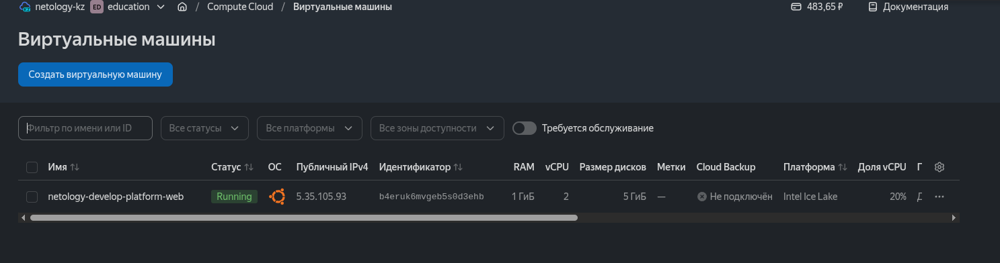
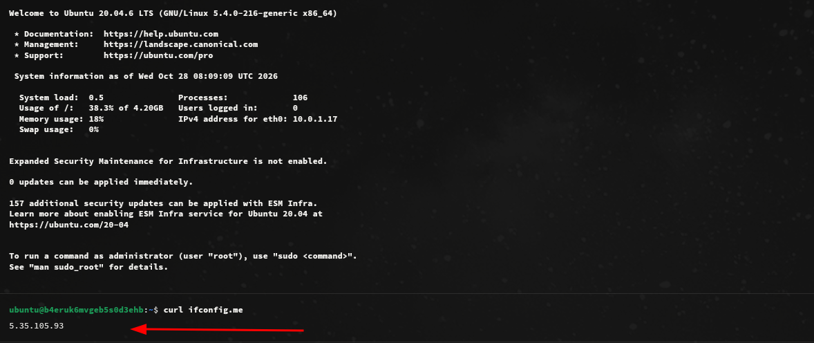
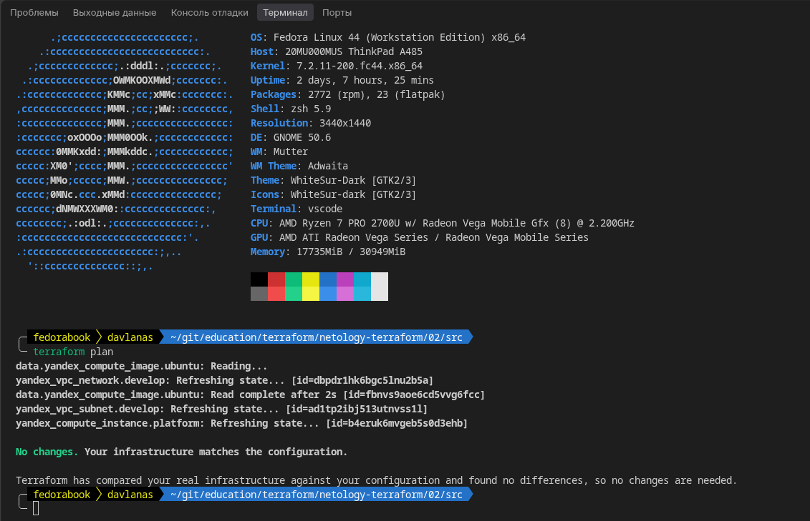
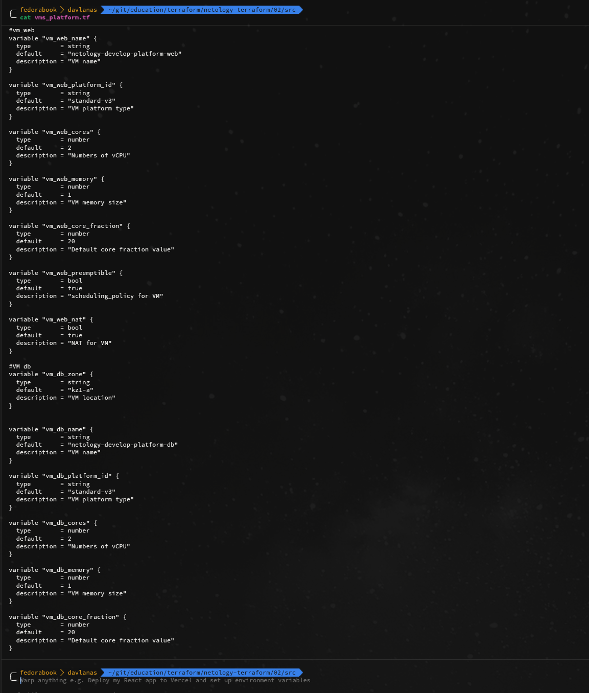
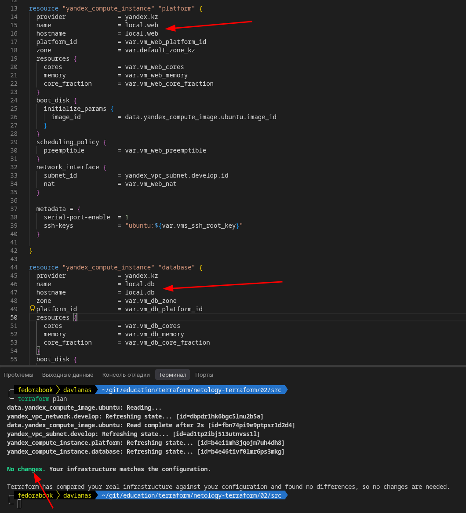
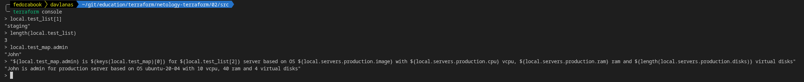
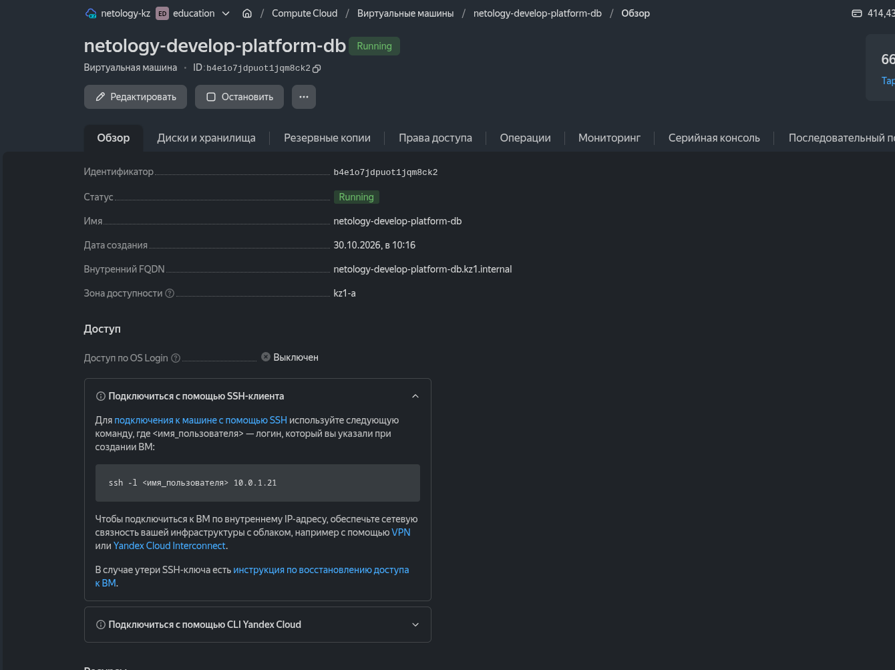
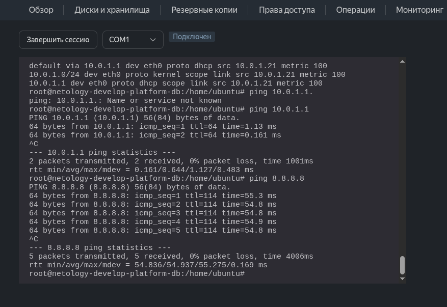

### Задание 1
## 4
1. Ошибка в слове standard (t вместо d в конце)
2. Ошибка в количестве ядер для используемой платформы (1, хотя минимально 2)
3. Ошибка в типе платформы. Нет платвормы standard-v4 (есть v4a, которая использует процессоры AMD). Т.к в текущий момент регион RU недоступен для выполнения ДЗ, мне пришлось использовать регион KZ. Там почему-то нет платформы V2, а в платформе V3 минимальное значение core_fraction это 20%. Пришлось изменить 5 на 20.
4. Содержимое файла providers.tf я заменил своим (опять же из-за проблем в регионе RU), но на сколько могу судить там была строка **service_account_key_file  = file("~/authorized_key-kz.json")** в которой функция file не смогла бы корректно развернуть относительный путь, да и в целом здесь лучше подходит **pathexpand**, который на любом ПК корректно развернет путь и проблем не должно возникнуть.

## 5
```
ubuntu@b4eruk6mvgeb5s0d3ehb:~$ curl ifconfig.me
5.35.105.93
```
## 6
**preemptible = true** - создает прерываемую ВМ, что снижает ее стоимость. \
**core_fraction=5** - Задает максимальную утилизацию процессора 5%. Так же снижает стоимость ВМ. \







### Задание 2
```
resource "yandex_vpc_network" "develop" {
  name = var.vpc_name
}
resource "yandex_vpc_subnet" "develop" {
  name           = var.vpc_name
  zone           = var.default_zone
  network_id     = yandex_vpc_network.develop.id
  v4_cidr_blocks = var.default_cidr
}


data "yandex_compute_image" "ubuntu" {
  family = var.image_family
}
resource "yandex_compute_instance" "platform" {
  name        = var.vm_web_name
  platform_id = var.vm_web_platform_id
  resources {
    cores         = var.vm_web_cores
    memory        = var.vm_web_memory
    core_fraction = var.vm_web_core_fraction
  }
  boot_disk {
    initialize_params {
      image_id = data.yandex_compute_image.ubuntu.image_id
    }
  }
  scheduling_policy {
    preemptible = var.vm_web_preemptible
  }
  network_interface {
    subnet_id = yandex_vpc_subnet.develop.id
    nat       = var.vm_web_nat
  }

  metadata = {
    serial-port-enable = 1
    ssh-keys           = "ubuntu:${var.vms_ssh_root_key}"
  }

}
```



### Задание 3




### Задание 4

```
output "vms" {
  description       = "Информация о ВМ: instance_name, external_ip, fqdn"

  value = {
    for key, vm in {
      platform      = yandex_compute_instance.platform
      database      = yandex_compute_instance.database
    } : key => {
      instance_name = vm.name
      external_ip   = try(vm.network_interface[0].nat_ip_address, null)
      fqdn          = vm.fqdn
    }
  }
}
```

### Задание 5

```
locals {
  web   = "${var.project}-${var.staging}-${var.product}-web"
  db    = "${var.project}-${var.staging}-${var.product}-db"
}
```



### Задание 6

Переменная **metadata**
```
metadata  = {
  connect = {
    serial-port-enable  = 1
    ssh-keys            = "ubuntu:ssh-rsa ***"
  }
}
```
В моем плане были изменения, т.к я указывал другие значения ОЗУ (большие чем прежде), чтобы был хоть какой-то смысл в переменной содержащей конфигурацию 2х ВМ. Хотя в целом смысл бы и так был, ведь после ее внедрения мы смогли бы отдельно настраивать эти ВМ.

### Задание 7

1. 
```
local.test_list[1]
"staging"
```
2. 
```
length(local.test_list)
3
```
3. 
```
local.test_map.admin
"John"
```
4. 
```
"${local.test_map.admin} is ${keys(local.test_map)[0]} for ${local.test_list[2]} server based on OS ${local.servers.production.image} with ${local.servers.production.cpu} vcpu, ${local.servers.production.ram} ram and ${length(local.servers.production.disks)} virtual disks"
"John is admin for production server based on OS ubuntu-20-04 with 10 vcpu, 40 ram and 4 virtual disks"
```


### Задание 8

Описание переменной:
```
variable "test" {
  type        = list(map(list(string)))
  default     = [
  {
    "dev1" = [
      "ssh -o 'StrictHostKeyChecking=no' ubuntu@62.84.124.117",
      "10.0.1.7",
    ]
  },
  {
    "dev2" = [
      "ssh -o 'StrictHostKeyChecking=no' ubuntu@84.252.140.88",
      "10.0.2.29",
    ]
  },
  {
    "prod1" = [
      "ssh -o 'StrictHostKeyChecking=no' ubuntu@51.250.2.101",
      "10.0.1.30",
    ]
  },
  ]
}
```
Выражение для получния строки "ssh -o 'StrictHostKeyChecking=no' ubuntu@62.84.124.117":
```
var.test[0].dev1[0]
```
### Задание 9




