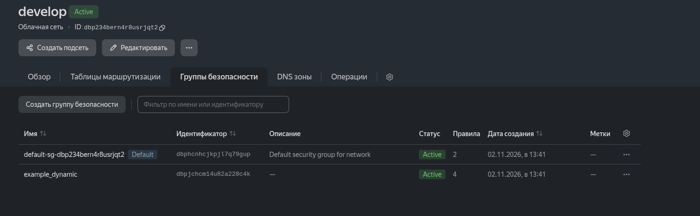
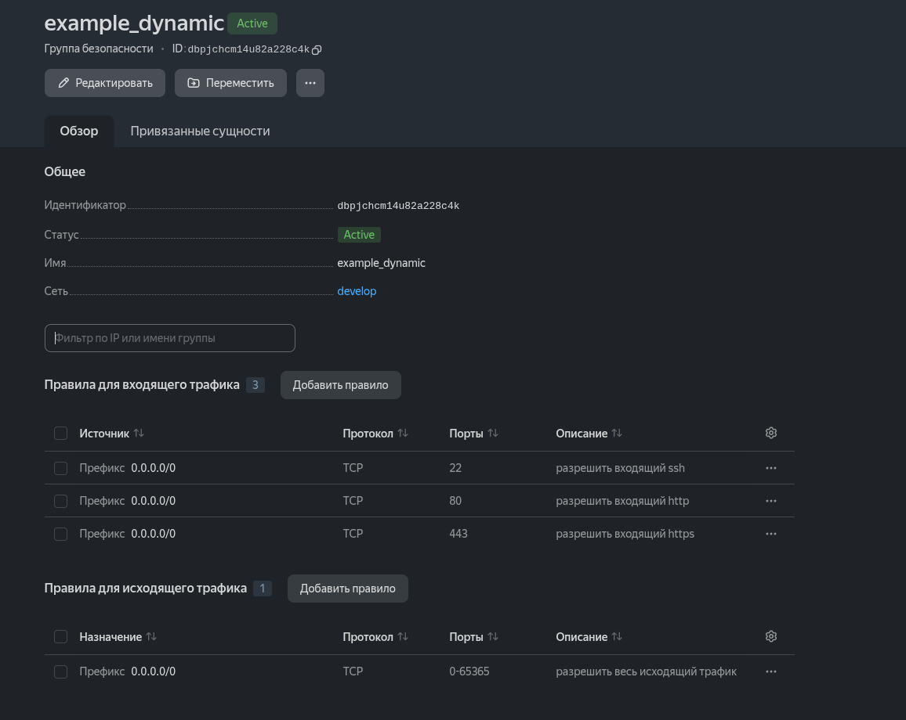
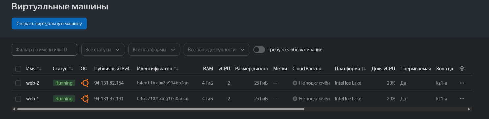
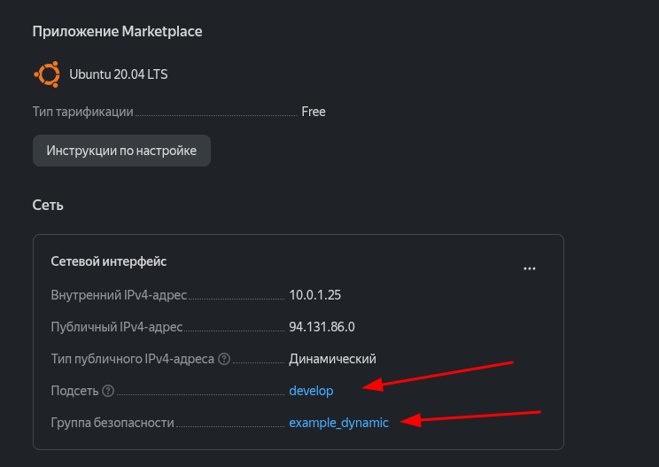
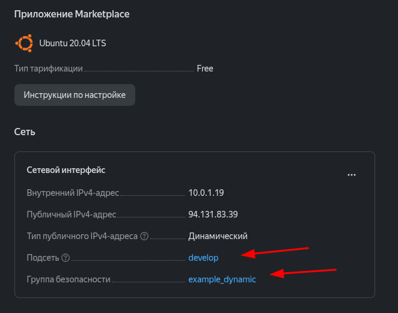
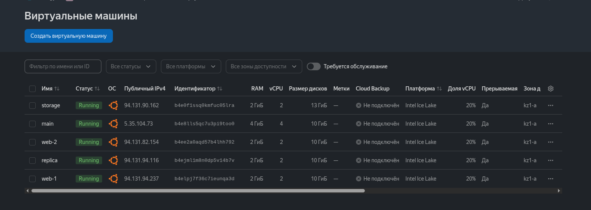
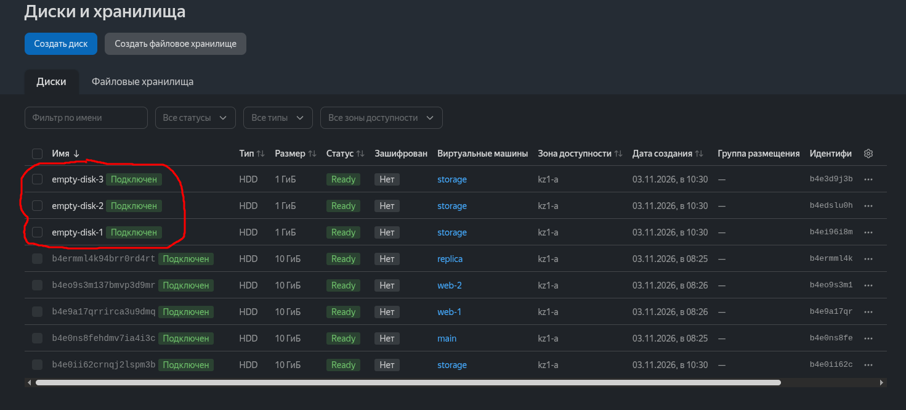
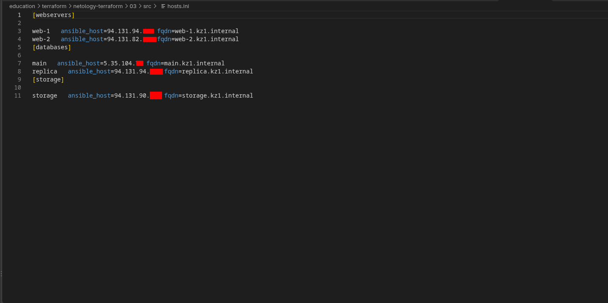
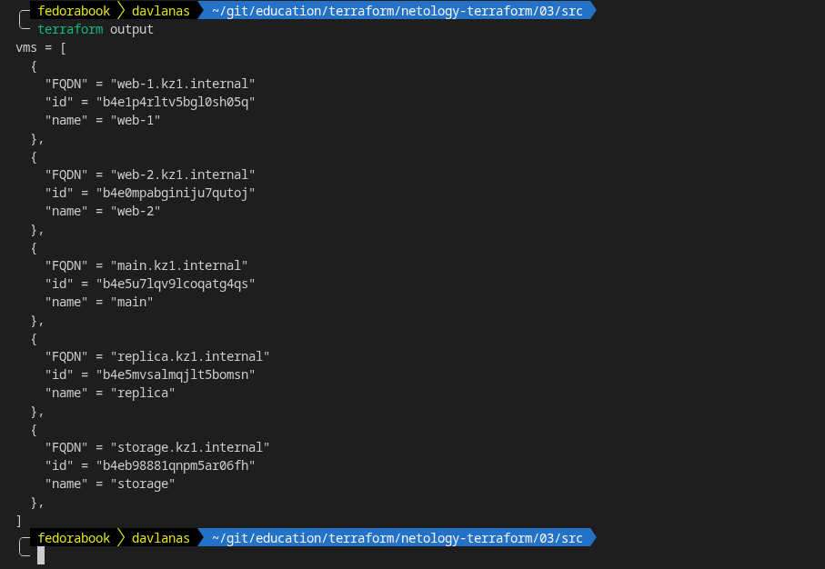

### Задание 1





### Задание 2

## 1







## 2



### Задание 3

## 1



### Задание 4

## 1



## 2

Шаблон для формирования инвентори:
```
[webservers]

%{~ for i in webservers ~}

${i["name"]}   ansible_host=${i["network_interface"][0]["nat_ip_address"]} fqdn=${i["fqdn"]}
%{~ endfor ~}

[databases]

%{~ for i in databases ~}

${i["name"]}   ansible_host=${i["network_interface"][0]["nat_ip_address"]} fqdn=${i["fqdn"]}
%{~ endfor ~}

[storage]

%{~ for i in storage ~}

${i["name"]}   ansible_host=${i["network_interface"][0]["nat_ip_address"]} fqdn=${i["fqdn"]}
%{~ endfor ~}
```

### Задание 5



### Задание 6

## 1 (Сказать, что задолбался - ничего не сказать. по итогу добавил remote-exec для мониторинга ssh. Так же сменил образ на 24.04, чтобы не мучаться, с python3.9, хотя через модуль raw вроде как и работало.)
```
yandex_vpc_network.develop: Creating...
yandex_compute_disk.empty-disk[2]: Creating...
yandex_compute_disk.empty-disk[1]: Creating...
yandex_compute_disk.empty-disk[0]: Creating...
yandex_vpc_network.develop: Creation complete after 2s [id=dbp0fd7gehgqoidq5odf]
yandex_vpc_subnet.develop: Creating...
yandex_vpc_security_group.example: Creating...
yandex_vpc_subnet.develop: Creation complete after 0s [id=ad184d010vnph65u393f]
yandex_vpc_security_group.example: Creation complete after 1s [id=dbpet8m8pr100o9q3iqk]
yandex_compute_instance.database["replica"]: Creating...
yandex_compute_instance.database["main"]: Creating...
yandex_compute_disk.empty-disk[2]: Creation complete after 7s [id=b4ecep6040644uuagtc8]
yandex_compute_disk.empty-disk[1]: Creation complete after 8s [id=b4e5dd0s94j259gb1jhe]
yandex_compute_disk.empty-disk[0]: Creation complete after 10s [id=b4e9vaeqv0regj786evs]
yandex_compute_instance.storage: Creating...
yandex_compute_instance.database["replica"]: Still creating... [00m10s elapsed]
yandex_compute_instance.database["main"]: Still creating... [00m10s elapsed]
yandex_compute_instance.storage: Still creating... [00m10s elapsed]
yandex_compute_instance.database["replica"]: Still creating... [00m20s elapsed]
yandex_compute_instance.database["main"]: Still creating... [00m20s elapsed]
yandex_compute_instance.database["replica"]: Creation complete after 27s [id=b4e9k78s5a58hvk7f9g7]
yandex_compute_instance.storage: Still creating... [00m20s elapsed]
yandex_compute_instance.database["main"]: Still creating... [00m30s elapsed]
yandex_compute_instance.database["main"]: Creation complete after 31s [id=b4etoq8m0gcacedch9pi]
yandex_compute_instance.web[0]: Creating...
yandex_compute_instance.web[1]: Creating...
yandex_compute_instance.storage: Creation complete after 24s [id=b4ectm01n4r67qupt7mn]
yandex_compute_instance.web[0]: Still creating... [00m10s elapsed]
yandex_compute_instance.web[1]: Still creating... [00m10s elapsed]
yandex_compute_instance.web[0]: Still creating... [00m20s elapsed]
yandex_compute_instance.web[1]: Still creating... [00m20s elapsed]
yandex_compute_instance.web[1]: Creation complete after 25s [id=b4e5klf5ib949ls2k8t5]
yandex_compute_instance.web[0]: Creation complete after 26s [id=b4ep5psev64ur6i1t70h]
local_file.hosts_templatefile: Creating...
local_file.hosts_templatefile: Creation complete after 0s [id=d6b82ab1f1053c380c52569de67d828ccb74ae70]
null_resource.ansible: Creating...
null_resource.ansible: Provisioning with 'remote-exec'...
null_resource.ansible (remote-exec): Connecting to remote host via SSH...
null_resource.ansible (remote-exec):   Host: 94.131.84.136
null_resource.ansible (remote-exec):   User: guskov-ka
null_resource.ansible (remote-exec):   Password: false
null_resource.ansible (remote-exec):   Private key: true
null_resource.ansible (remote-exec):   Certificate: false
null_resource.ansible (remote-exec):   SSH Agent: true
null_resource.ansible (remote-exec):   Checking Host Key: false
null_resource.ansible (remote-exec):   Target Platform: unix
null_resource.ansible: Still creating... [00m10s elapsed]
null_resource.ansible (remote-exec): Connecting to remote host via SSH...
null_resource.ansible (remote-exec):   Host: 94.131.84.136
null_resource.ansible (remote-exec):   User: guskov-ka
null_resource.ansible (remote-exec):   Password: false
null_resource.ansible (remote-exec):   Private key: true
null_resource.ansible (remote-exec):   Certificate: false
null_resource.ansible (remote-exec):   SSH Agent: true
null_resource.ansible (remote-exec):   Checking Host Key: false
null_resource.ansible (remote-exec):   Target Platform: unix
null_resource.ansible (remote-exec): Connecting to remote host via SSH...
null_resource.ansible (remote-exec):   Host: 94.131.84.136
null_resource.ansible (remote-exec):   User: guskov-ka
null_resource.ansible (remote-exec):   Password: false
null_resource.ansible (remote-exec):   Private key: true
null_resource.ansible (remote-exec):   Certificate: false
null_resource.ansible (remote-exec):   SSH Agent: true
null_resource.ansible (remote-exec):   Checking Host Key: false
null_resource.ansible (remote-exec):   Target Platform: unix
null_resource.ansible: Still creating... [00m20s elapsed]
null_resource.ansible (remote-exec): Connecting to remote host via SSH...
null_resource.ansible (remote-exec):   Host: 94.131.84.136
null_resource.ansible (remote-exec):   User: guskov-ka
null_resource.ansible (remote-exec):   Password: false
null_resource.ansible (remote-exec):   Private key: true
null_resource.ansible (remote-exec):   Certificate: false
null_resource.ansible (remote-exec):   SSH Agent: true
null_resource.ansible (remote-exec):   Checking Host Key: false
null_resource.ansible (remote-exec):   Target Platform: unix
null_resource.ansible: Still creating... [00m30s elapsed]
null_resource.ansible (remote-exec): Connecting to remote host via SSH...
null_resource.ansible (remote-exec):   Host: 94.131.84.136
null_resource.ansible (remote-exec):   User: guskov-ka
null_resource.ansible (remote-exec):   Password: false
null_resource.ansible (remote-exec):   Private key: true
null_resource.ansible (remote-exec):   Certificate: false
null_resource.ansible (remote-exec):   SSH Agent: true
null_resource.ansible (remote-exec):   Checking Host Key: false
null_resource.ansible (remote-exec):   Target Platform: unix
null_resource.ansible (remote-exec): Connected!
null_resource.ansible (remote-exec): SSH is ready
null_resource.ansible: Provisioning with 'local-exec'...
null_resource.ansible (local-exec): Executing: ["/bin/sh" "-c" "ANSIBLE_CONFIG=/home/davlanas/git/education/terraform/netology-terraform/03/src/ansible.cfg ansible-playbook -i /home/davlanas/git/education/terraform/netology-terraform/03/src/hosts.ini /home/davlanas/git/education/terraform/netology-terraform/03/src/test.yml"]

null_resource.ansible (local-exec): PLAY [Test] ********************************************************************

null_resource.ansible (local-exec): TASK [Validating the ssh port is open] *****************************************
null_resource.ansible: Still creating... [00m40s elapsed]
null_resource.ansible (local-exec): [WARNING]: Host 'web-1' is using the discovered Python interpreter at '/usr/bin/python3.12', but future installation of another Python interpreter could cause a different interpreter to be discovered. See https://docs.ansible.com/ansible-core/2.20/reference_appendices/interpreter_discovery.html for more information.
null_resource.ansible (local-exec): [WARNING]: Host 'web-2' is using the discovered Python interpreter at '/usr/bin/python3.12', but future installation of another Python interpreter could cause a different interpreter to be discovered. See https://docs.ansible.com/ansible-core/2.20/reference_appendices/interpreter_discovery.html for more information.
null_resource.ansible (local-exec): ok: [web-1]
null_resource.ansible (local-exec): ok: [web-2]

null_resource.ansible (local-exec): TASK [Wait for cloud-init to finish] *******************************************
null_resource.ansible: Still creating... [00m50s elapsed]
null_resource.ansible (local-exec): ok: [web-2]
null_resource.ansible (local-exec): ok: [web-1]

null_resource.ansible (local-exec): TASK [Create own secret] *******************************************************
null_resource.ansible (local-exec): skipping: [web-1]
null_resource.ansible (local-exec): skipping: [web-2]

null_resource.ansible (local-exec): TASK [Create all secrets] ******************************************************
null_resource.ansible (local-exec): skipping: [web-1]
null_resource.ansible (local-exec): skipping: [web-2]

null_resource.ansible (local-exec): PLAY RECAP *********************************************************************
null_resource.ansible (local-exec): web-1                      : ok=2    changed=0    unreachable=0    failed=0    skipped=2    rescued=0    ignored=0
null_resource.ansible (local-exec): web-2                      : ok=2    changed=0    unreachable=0    failed=0    skipped=2    rescued=0    ignored=0

null_resource.ansible: Creation complete after 51s [id=439471179206609649]

Apply complete! Resources: 13 added, 0 changed, 0 destroyed.

Outputs:

vms = [
  {
    "FQDN" = "web-1.kz1.internal"
    "id" = "b4ep5psev64ur6i1t70h"
    "name" = "web-1"
  },
  {
    "FQDN" = "web-2.kz1.internal"
    "id" = "b4e5klf5ib949ls2k8t5"
    "name" = "web-2"
  },
  {
    "FQDN" = "main.kz1.internal"
    "id" = "b4etoq8m0gcacedch9pi"
    "name" = "main"
  },
  {
    "FQDN" = "replica.kz1.internal"
    "id" = "b4e9k78s5a58hvk7f9g7"
    "name" = "replica"
  },
  {
    "FQDN" = "storage.kz1.internal"
    "id" = "b4ectm01n4r67qupt7mn"
    "name" = "storage"
  },
]
```

## 2

```
merge(local.vpc, {
  subnet_ids   = [for i, v in local.vpc.subnet_ids : v if i != 2]
  subnet_zones = [for i, v in local.vpc.subnet_zones : v if i != 2]
})
```

### Задание 8

```
[webservers]
%{~ for i in webservers ~}
${i["name"]} ansible_host=${i["network_interface"][0]["nat_ip_address"]} platform_id=${i["platform_id"]}
%{~ endfor ~}
```

### Задание 9

## 1

```
[for i in range(1, 100) : format("rc%02d", i)]
```

## 2

```
[for i in range(1, 97) : format("rc%02d", i) if !contains([0, 7, 8, 9], i % 10) || i == 19]
```