### Задание 1


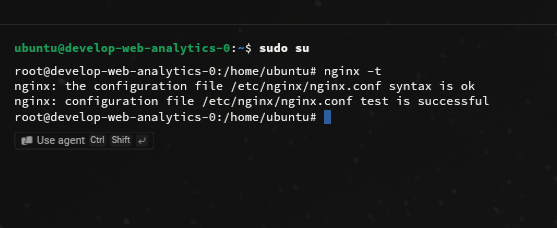

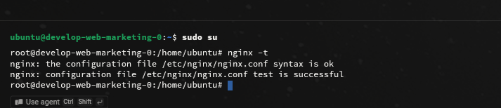

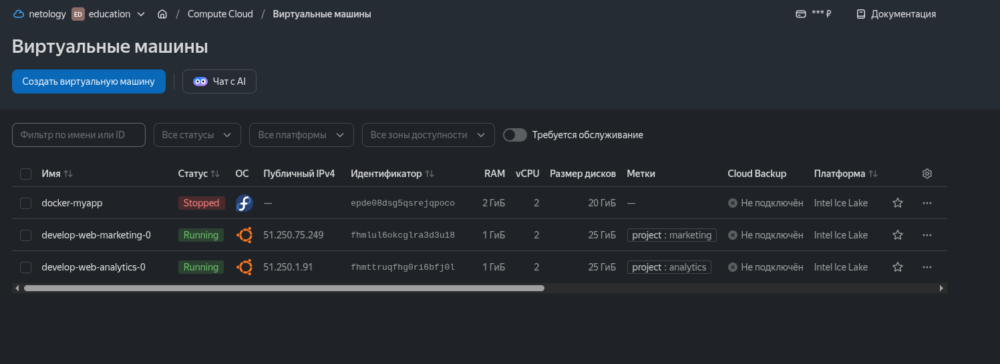

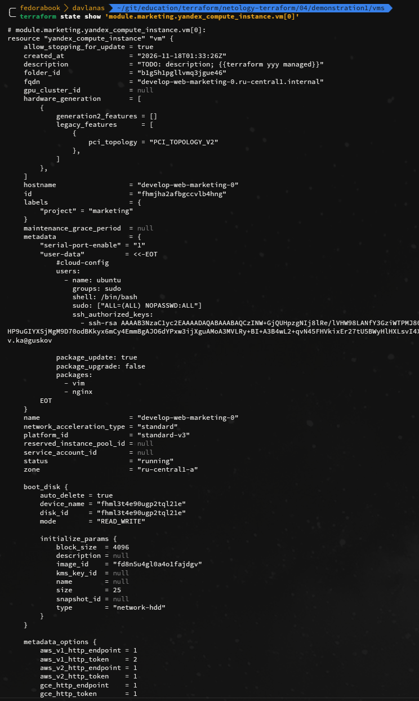

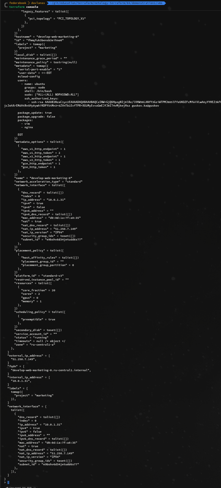

### Задание 2

Документация для модуля.

## Requirements

| Name | Version |
|------|---------|
| <a name="requirement_terraform"></a> [terraform](#requirement\_terraform) | ~>1.16.0 |

## Providers

| Name | Version |
|------|---------|
| <a name="provider_yandex"></a> [yandex](#provider\_yandex) | n/a |

## Modules

No modules.

## Resources

| Name | Type |
|------|------|
| [yandex_vpc_network.vpc](https://registry.terraform.io/providers/yandex-cloud/yandex/latest/docs/resources/vpc_network) | resource |
| [yandex_vpc_subnet.subnet](https://registry.terraform.io/providers/yandex-cloud/yandex/latest/docs/resources/vpc_subnet) | resource |

## Inputs

| Name | Description | Type | Default | Required |
|------|-------------|------|---------|:--------:|
| <a name="input_env_name"></a> [env\_name](#input\_env\_name) | Environment name | `string` | n/a | yes |
| <a name="input_v4_cidr_blocks"></a> [v4\_cidr\_blocks](#input\_v4\_cidr\_blocks) | CIDR blocks for subnet | `list(string)` | n/a | yes |
| <a name="input_zone"></a> [zone](#input\_zone) | Location name | `string` | n/a | yes |

## Outputs

| Name | Description |
|------|-------------|
| <a name="output_network_id"></a> [network\_id](#output\_network\_id) | Network ID for root module usage |
| <a name="output_network_name"></a> [network\_name](#output\_network\_name) | VPC name |
| <a name="output_subnet_id"></a> [subnet\_id](#output\_subnet\_id) | Subnet ID for root module usage |
| <a name="output_subnet_name"></a> [subnet\_name](#output\_subnet\_name) | Subnet name |
| <a name="output_v4_cidr_blocks"></a> [v4\_cidr\_blocks](#output\_v4\_cidr\_blocks) | CIDR blocks for subnet |


### Задание 3

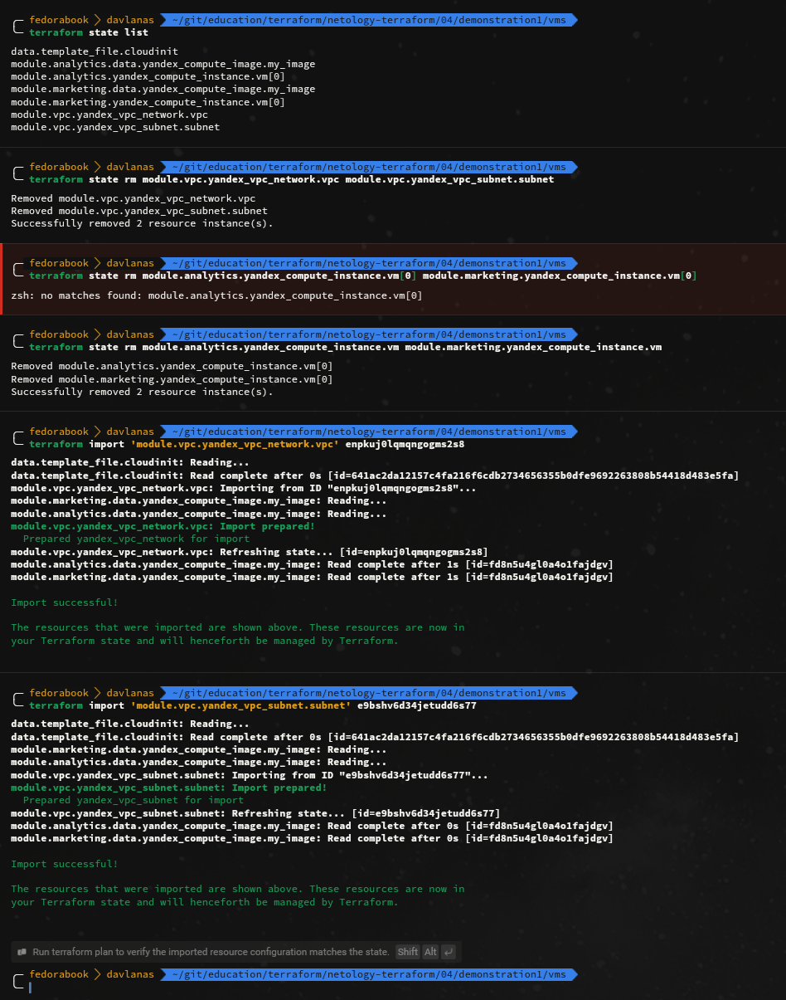

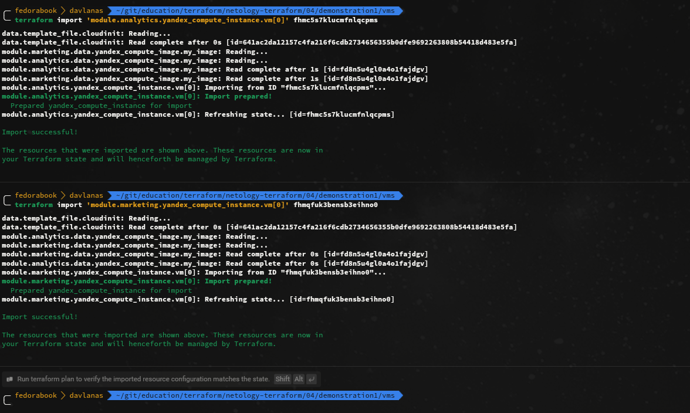

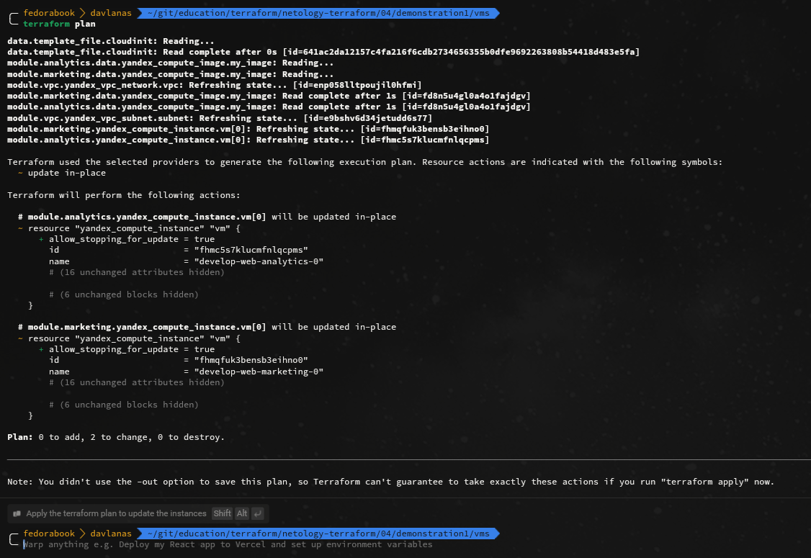


```
$terraform state list
$terraform state rm module.vpc.yandex_vpc_network.vpc module.vpc.yandex_vpc_subnet.subnet
$terraform state rm module.analytics.yandex_compute_instance.vm module.marketing.yandex_compute_instance.vm
$terraform import 'module.vpc.yandex_vpc_network.vpc' enp058lltpoujil0hfmi
$terraform import 'module.vpc.yandex_vpc_subnet.subnet' e9bshv6d34jetudd6s77
$terraform import 'module.analytics.yandex_compute_instance.vm[0]' fhmc5s7klucmfnlqcpms
$terraform import 'module.marketing.yandex_compute_instance.vm[0]' fhmqfuk3bensb3eihno0
```

### Задание 4

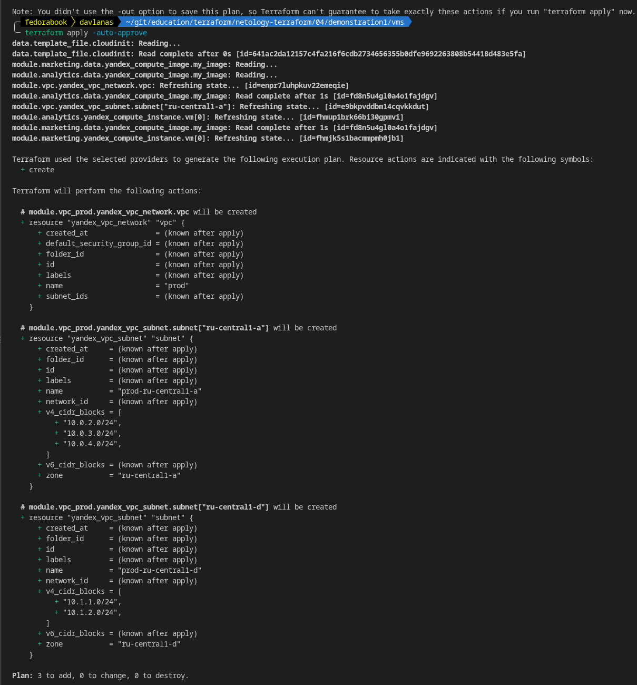

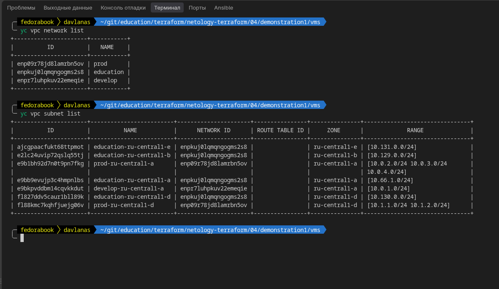

### Задание 5

```
data.template_file.cloudinit: Reading...
data.template_file.cloudinit: Read complete after 0s [id=641ac2da12157c4fa216f6cdb2734656355b0dfe9692263808b54418d483e5fa]

Terraform used the selected providers to generate the following execution plan. Resource actions are indicated with the following symbols:
  + create
 <= read (data resources)

Terraform will perform the following actions:

  # module.analytics.data.yandex_compute_image.my_image will be read during apply
  # (depends on a resource or a module with changes pending)
 <= data "yandex_compute_image" "my_image" {
      + created_at          = (known after apply)
      + description         = (known after apply)
      + family              = "ubuntu-2404-lts"
      + folder_id           = (known after apply)
      + hardware_generation = (known after apply)
      + id                  = (known after apply)
      + image_id            = (known after apply)
      + kms_key_id          = (known after apply)
      + labels              = (known after apply)
      + min_disk_size       = (known after apply)
      + name                = (known after apply)
      + os_type             = (known after apply)
      + pooled              = (known after apply)
      + product_ids         = (known after apply)
      + size                = (known after apply)
      + status              = (known after apply)
    }

  # module.analytics.yandex_compute_instance.vm[0] will be created
  + resource "yandex_compute_instance" "vm" {
      + allow_stopping_for_update = true
      + created_at                = (known after apply)
      + description               = "TODO: description; {{terraform yyy managed}}"
      + folder_id                 = (known after apply)
      + fqdn                      = (known after apply)
      + gpu_cluster_id            = (known after apply)
      + hardware_generation       = (known after apply)
      + hostname                  = "develop-web-analytics-0"
      + id                        = (known after apply)
      + labels                    = {
          + "project" = "analytics"
        }
      + maintenance_grace_period  = (known after apply)
      + maintenance_policy        = (known after apply)
      + metadata                  = {
          + "serial-port-enable" = "1"
          + "user-data"          = <<-EOT
                #cloud-config
                users:
                  - name: ubuntu
                    groups: sudo
                    shell: /bin/bash
                    sudo: ["ALL=(ALL) NOPASSWD:ALL"]
                    ssh_authorized_keys:
                      - ssh-rsa ***
                
                package_update: true
                package_upgrade: false
                packages:
                  - vim
                  - nginx
            EOT
        }
      + name                      = "develop-web-analytics-0"
      + network_acceleration_type = "standard"
      + platform_id               = "standard-v3"
      + reserved_instance_pool_id = (known after apply)
      + status                    = (known after apply)
      + zone                      = "ru-central1-a"

      + boot_disk {
          + auto_delete = true
          + device_name = (known after apply)
          + disk_id     = (known after apply)
          + mode        = (known after apply)

          + initialize_params {
              + block_size  = (known after apply)
              + description = (known after apply)
              + image_id    = (known after apply)
              + name        = (known after apply)
              + size        = 10
              + snapshot_id = (known after apply)
              + type        = "network-hdd"
            }
        }

      + metadata_options (known after apply)

      + network_interface {
          + index          = (known after apply)
          + ip_address     = (known after apply)
          + ipv4           = true
          + ipv6           = (known after apply)
          + ipv6_address   = (known after apply)
          + mac_address    = (known after apply)
          + nat            = true
          + nat_ip_address = (known after apply)
          + nat_ip_version = (known after apply)
          + subnet_id      = (known after apply)
        }

      + placement_policy (known after apply)

      + resources {
          + core_fraction = 20
          + cores         = 2
          + memory        = 1
        }

      + scheduling_policy {
          + preemptible = true
        }
    }

  # module.db-user.random_password.user_passwords["app"] will be created
  + resource "random_password" "user_passwords" {
      + bcrypt_hash      = (sensitive value)
      + id               = (known after apply)
      + length           = 16
      + lower            = true
      + min_lower        = 2
      + min_numeric      = 2
      + min_special      = 2
      + min_upper        = 2
      + number           = true
      + numeric          = true
      + override_special = "!#$%&*()-_=+[]{}<>:?"
      + result           = (sensitive value)
      + special          = true
      + upper            = true
    }

  # module.db-user.yandex_mdb_mysql_database.db will be created
  + resource "yandex_mdb_mysql_database" "db" {
      + cluster_id = (known after apply)
      + id         = (known after apply)
      + name       = "test"
    }

  # module.db-user.yandex_mdb_mysql_user.users["app"] will be created
  + resource "yandex_mdb_mysql_user" "users" {
      + authentication_plugin = (known after apply)
      + cluster_id            = (known after apply)
      + connection_manager    = (known after apply)
      + generate_password     = false
      + id                    = (known after apply)
      + name                  = "app"
      + password              = (sensitive value)
      + password_wo           = (write-only attribute)

      + connection_limits (known after apply)

      + permission {
          + database_name = "test"
          + roles         = [
              + "ALL",
            ]
        }

      + user_connection_manager (known after apply)
    }

  # module.marketing.data.yandex_compute_image.my_image will be read during apply
  # (depends on a resource or a module with changes pending)
 <= data "yandex_compute_image" "my_image" {
      + created_at          = (known after apply)
      + description         = (known after apply)
      + family              = "ubuntu-2404-lts"
      + folder_id           = (known after apply)
      + hardware_generation = (known after apply)
      + id                  = (known after apply)
      + image_id            = (known after apply)
      + kms_key_id          = (known after apply)
      + labels              = (known after apply)
      + min_disk_size       = (known after apply)
      + name                = (known after apply)
      + os_type             = (known after apply)
      + pooled              = (known after apply)
      + product_ids         = (known after apply)
      + size                = (known after apply)
      + status              = (known after apply)
    }

  # module.marketing.yandex_compute_instance.vm[0] will be created
  + resource "yandex_compute_instance" "vm" {
      + allow_stopping_for_update = true
      + created_at                = (known after apply)
      + description               = "TODO: description; {{terraform yyy managed}}"
      + folder_id                 = (known after apply)
      + fqdn                      = (known after apply)
      + gpu_cluster_id            = (known after apply)
      + hardware_generation       = (known after apply)
      + hostname                  = "develop-web-marketing-0"
      + id                        = (known after apply)
      + labels                    = {
          + "project" = "marketing"
        }
      + maintenance_grace_period  = (known after apply)
      + maintenance_policy        = (known after apply)
      + metadata                  = {
          + "serial-port-enable" = "1"
          + "user-data"          = <<-EOT
                #cloud-config
                users:
                  - name: ubuntu
                    groups: sudo
                    shell: /bin/bash
                    sudo: ["ALL=(ALL) NOPASSWD:ALL"]
                    ssh_authorized_keys:
                      - ssh-rsa ***
                
                package_update: true
                package_upgrade: false
                packages:
                  - vim
                  - nginx
            EOT
        }
      + name                      = "develop-web-marketing-0"
      + network_acceleration_type = "standard"
      + platform_id               = "standard-v3"
      + reserved_instance_pool_id = (known after apply)
      + status                    = (known after apply)
      + zone                      = "ru-central1-a"

      + boot_disk {
          + auto_delete = true
          + device_name = (known after apply)
          + disk_id     = (known after apply)
          + mode        = (known after apply)

          + initialize_params {
              + block_size  = (known after apply)
              + description = (known after apply)
              + image_id    = (known after apply)
              + name        = (known after apply)
              + size        = 10
              + snapshot_id = (known after apply)
              + type        = "network-hdd"
            }
        }

      + metadata_options (known after apply)

      + network_interface {
          + index          = (known after apply)
          + ip_address     = (known after apply)
          + ipv4           = true
          + ipv6           = (known after apply)
          + ipv6_address   = (known after apply)
          + mac_address    = (known after apply)
          + nat            = true
          + nat_ip_address = (known after apply)
          + nat_ip_version = (known after apply)
          + subnet_id      = (known after apply)
        }

      + placement_policy (known after apply)

      + resources {
          + core_fraction = 20
          + cores         = 2
          + memory        = 1
        }

      + scheduling_policy {
          + preemptible = true
        }
    }

  # module.mdb-cluster.yandex_mdb_mysql_cluster.cluster will be created
  + resource "yandex_mdb_mysql_cluster" "cluster" {
      + allow_regeneration_host   = false
      + backup_retain_period_days = (known after apply)
      + created_at                = (known after apply)
      + deletion_protection       = true
      + disk_encryption_key_id    = (known after apply)
      + environment               = "PRESTABLE"
      + folder_id                 = (known after apply)
      + health                    = (known after apply)
      + host_group_ids            = (known after apply)
      + id                        = (known after apply)
      + mysql_config              = (known after apply)
      + name                      = "example"
      + network_id                = (known after apply)
      + status                    = (known after apply)
      + version                   = "8.4"

      + access (known after apply)

      + backup_window_start (known after apply)

      + connection_manager (known after apply)

      + disk_size_autoscaling (known after apply)

      + host {
          + assign_public_ip   = false
          + backup_priority    = 0
          + fqdn               = (known after apply)
          + priority           = 0
          + replication_source = (known after apply)
          + subnet_id          = (known after apply)
          + zone               = "ru-central1-a"
        }

      + maintenance_window (known after apply)

      + performance_diagnostics (known after apply)

      + resources {
          + disk_size          = 10
          + disk_type_id       = "network-hdd"
          + resource_preset_id = "b2.medium"
        }
    }

  # module.vpc.yandex_vpc_network.vpc will be created
  + resource "yandex_vpc_network" "vpc" {
      + created_at                = (known after apply)
      + default_security_group_id = (known after apply)
      + folder_id                 = (known after apply)
      + id                        = (known after apply)
      + labels                    = (known after apply)
      + name                      = "develop"
      + subnet_ids                = (known after apply)
    }

  # module.vpc.yandex_vpc_subnet.subnet["ru-central1-a"] will be created
  + resource "yandex_vpc_subnet" "subnet" {
      + created_at     = (known after apply)
      + folder_id      = (known after apply)
      + id             = (known after apply)
      + labels         = (known after apply)
      + name           = "develop-ru-central1-a"
      + network_id     = (known after apply)
      + v4_cidr_blocks = [
          + "10.0.1.0/24",
        ]
      + v6_cidr_blocks = (known after apply)
      + zone           = "ru-central1-a"
    }

  # module.vpc_prod.yandex_vpc_network.vpc will be created
  + resource "yandex_vpc_network" "vpc" {
      + created_at                = (known after apply)
      + default_security_group_id = (known after apply)
      + folder_id                 = (known after apply)
      + id                        = (known after apply)
      + labels                    = (known after apply)
      + name                      = "prod"
      + subnet_ids                = (known after apply)
    }

  # module.vpc_prod.yandex_vpc_subnet.subnet["ru-central1-a"] will be created
  + resource "yandex_vpc_subnet" "subnet" {
      + created_at     = (known after apply)
      + folder_id      = (known after apply)
      + id             = (known after apply)
      + labels         = (known after apply)
      + name           = "prod-ru-central1-a"
      + network_id     = (known after apply)
      + v4_cidr_blocks = [
          + "10.0.2.0/24",
          + "10.0.3.0/24",
          + "10.0.4.0/24",
        ]
      + v6_cidr_blocks = (known after apply)
      + zone           = "ru-central1-a"
    }

  # module.vpc_prod.yandex_vpc_subnet.subnet["ru-central1-d"] will be created
  + resource "yandex_vpc_subnet" "subnet" {
      + created_at     = (known after apply)
      + folder_id      = (known after apply)
      + id             = (known after apply)
      + labels         = (known after apply)
      + name           = "prod-ru-central1-d"
      + network_id     = (known after apply)
      + v4_cidr_blocks = [
          + "10.1.1.0/24",
          + "10.1.2.0/24",
        ]
      + v6_cidr_blocks = (known after apply)
      + zone           = "ru-central1-d"
    }

Plan: 11 to add, 0 to change, 0 to destroy.

Changes to Outputs:
  + db-users    = [
      + {
          + database = "test"
          + roles    = [
              + "ALL",
            ]
          + username = "app"
        },
    ]
  + out         = [
      + (known after apply),
      + (known after apply),
    ]
  + subnet_name = {
      + ru-central1-a = "prod-ru-central1-a"
      + ru-central1-d = "prod-ru-central1-d"
    }
  + subnets     = {
      + ru-central1-a = [
          + "10.0.2.0/24",
          + "10.0.3.0/24",
          + "10.0.4.0/24",
        ]
      + ru-central1-d = [
          + "10.1.1.0/24",
          + "10.1.2.0/24",
        ]
    }
  + vpc_name    = "prod"

──────────────────────────────────────────────────────────────────────────────────────────────────────────────────────────────────────────────────────────────────────────────────────────────────────────

Note: You didn't use the -out option to save this plan, so Terraform can't guarantee to take exactly these actions if you run "terraform apply" now.
```

Весь вывод apply не закидываю сюда, т.к очень долго создается кластер и потому 
```
Apply complete! Resources: 11 added, 0 changed, 0 destroyed.

Outputs:

db-users = [
  {
    "database" = "test"
    "roles" = tolist([
      "ALL",
    ])
    "username" = "app"
  },
]
out = [
  "develop-web-marketing-0.ru-central1.internal",
  "develop-web-analytics-0.ru-central1.internal",
]
subnet_name = {
  "ru-central1-a" = "prod-ru-central1-a"
  "ru-central1-d" = "prod-ru-central1-d"
}
subnets = {
  "ru-central1-a" = tolist([
    "10.0.2.0/24",
    "10.0.3.0/24",
    "10.0.4.0/24",
  ])
  "ru-central1-d" = tolist([
    "10.1.1.0/24",
    "10.1.2.0/24",
  ])
}
vpc_name = "prod"
```

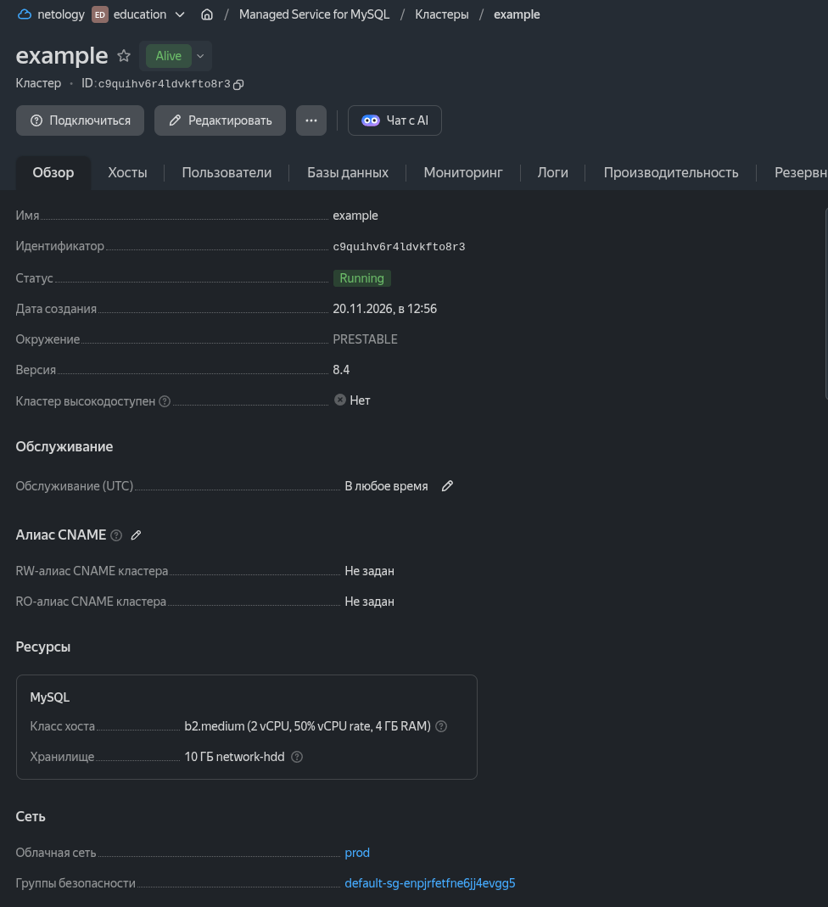

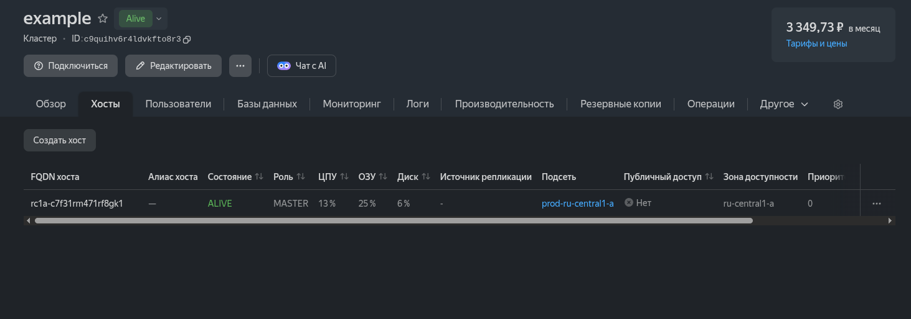

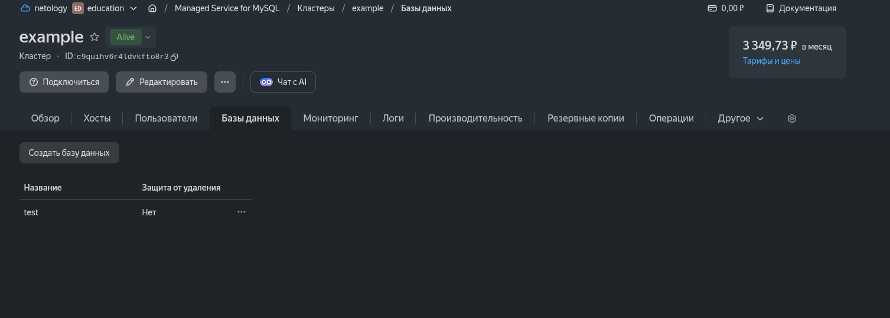

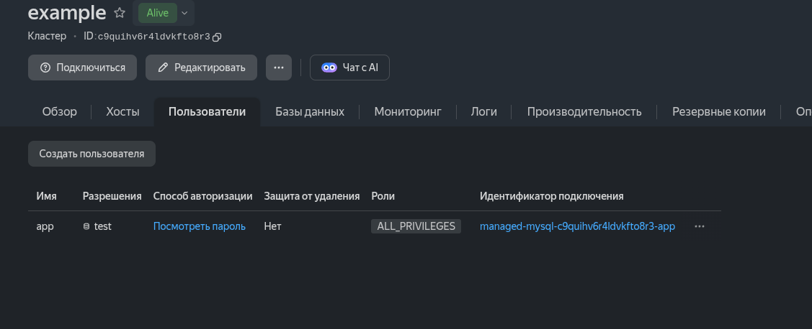

## После изменения переменной

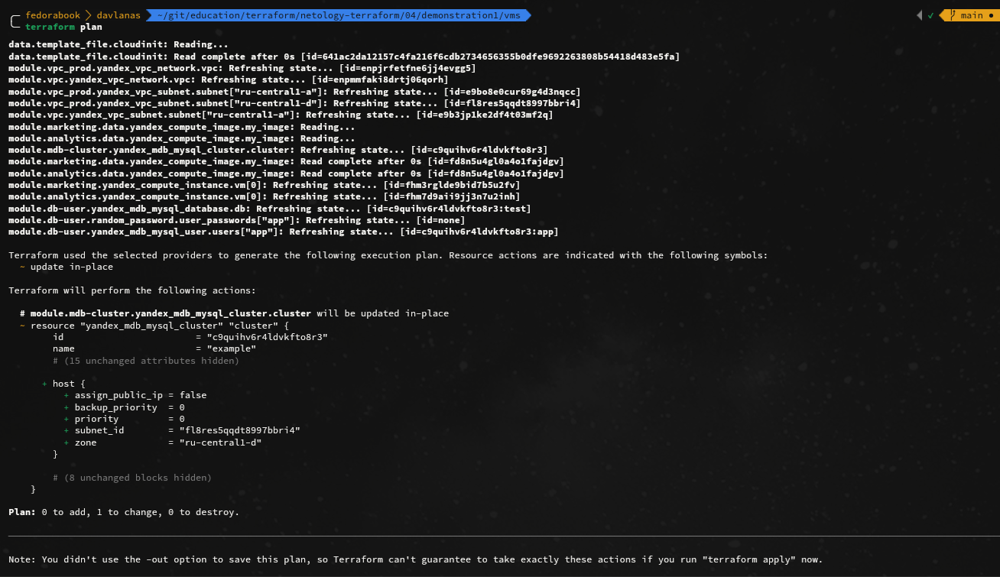

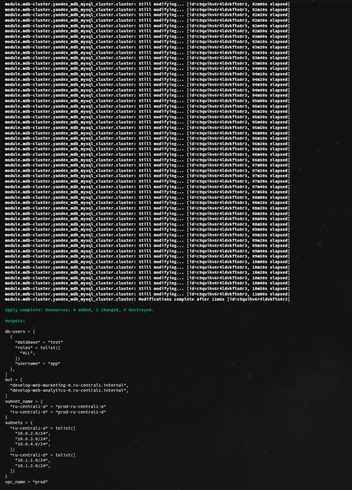

### Задание 6

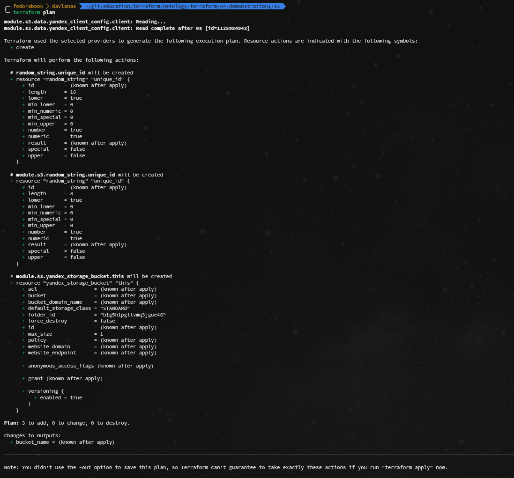

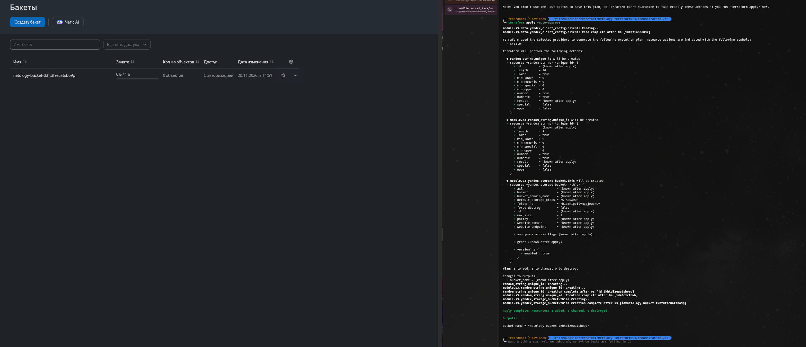

### Задание 7

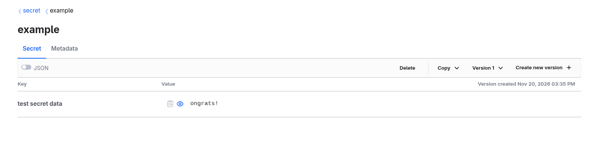

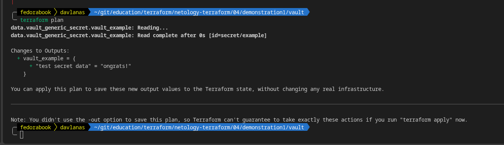