# Задание 1

## Checckov

### ДЗ к лекции №4
При сканировании именно моего кода из ДЗ №4
```
Ошибки сканирования секретов (1):

CKV_SECRET_6: "Base64 High Entropy String" — файл /vault/main.tf, строка 4.

Ошибки сканирования Terraform (4):

CKV_YC_2: "Ensure compute instance does not have public IP." — ресурсы module.analytics.yandex_compute_instance.vm[0] и module.marketing.yandex_compute_instance.vm[0].
CKV_YC_11: "Ensure security group is assigned to network interface." — ресурсы module.analytics.yandex_compute_instance.vm[0] и module.marketing.yandex_compute_instance.vm[0].
CKV_TF_1: "Ensure Terraform module sources use a commit hash" — ресурсы marketing (файлы /remote-state/vms/main.tf, /vms/main.tf), analytics (файлы /remote-state/vms/main.tf, /vms/main.tf) и s3 (файл /s3/main.tf).
CKV_TF_2: "Ensure Terraform module sources use a tag with a version number" — ресурсы marketing (файлы /remote-state/vms/main.tf, /vms/main.tf), analytics (файлы /remote-state/vms/main.tf, /vms/main.tf) и s3 (файл /s3/main.tf).
CKV_YC_1: "Ensure security group is assigned to database cluster." — ресурс module.mdb-cluster.yandex_mdb_mysql_cluster.cluster (файл /vms/modules/mdb-cluster/main.tf).
```
### Demo к лекции №4
```
Ошибки сканирования Terraform (4):

CKV_YC_2: "Ensure compute instance does not have public IP." — ресурсы module.example-vm.yandex_compute_instance.vm[0], module.test-vm.yandex_compute_instance.vm[0] и module.test-vm.yandex_compute_instance.vm[1].
CKV_YC_11: "Ensure security group is assigned to network interface." — ресурсы module.example-vm.yandex_compute_instance.vm[0], module.test-vm.yandex_compute_instance.vm[0] и module.test-vm.yandex_compute_instance.vm[1].
CKV_TF_1: "Ensure Terraform module sources use a commit hash" — ресурсы test-vm и example-vm (файл /vms/main.tf).
CKV_TF_2: "Ensure Terraform module sources use a tag with a version number" — ресурсы test-vm и example-vm (файл /vms/main.tf).
```

## TFLint

### ДЗ к заданию №4
```
╭─ fedorabook  davlanas  ~/git/education/terraform/netology-terraform/04/src                                                                                                                                                                                                                                                                 ✔   main ?  79% 🔋  13:19:12 
╰─ docker run --rm -v $(pwd):/data -t ghcr.io/terraform-linters/tflint
```
Ошибок не обнаружно.


### Demo к лекции №4
```
─ fedorabook  davlanas  ~/git/education/terraform/ter-homeworks/04                                                                                                                                                                                                                                                                        ✔   main ● ?  79% 🔋  13:15:25 
╰─ cd demonstration1
╭─ fedorabook  davlanas  ~/git/education/terraform/ter-homeworks/04/demonstration1                                                                                                                                                                                                                                                         ✔   main ● ?  79% 🔋  13:15:31 
╰─ docker run --rm -v $(pwd):/data -t ghcr.io/terraform-linters/tflint
╭─ fedorabook  davlanas  ~/git/education/terraform/ter-homeworks/04/demonstration1                                                                                                                                                                                                                                                         ✔   main ● ?  79% 🔋  13:15:35 
╰─ cd ../demonstration3                                               
╭─ fedorabook  davlanas  ~/git/education/terraform/ter-homeworks/04/demonstration3                                                                                                                                                                                                                                                         ✔   main ● ?  79% 🔋  13:15:45 
╰─ docker run --rm -v $(pwd):/data -t ghcr.io/terraform-linters/tflint
2 issue(s) found:

Warning: Missing version constraint for provider "yandex" in `required_providers` (terraform_required_providers)

  on providers.tf line 3:
   3:     yandex = {
   4:       source = "yandex-cloud/yandex"
   5:     }

Reference: https://github.com/terraform-linters/tflint-ruleset-terraform/blob/v0.17.0/docs/rules/terraform_required_providers.md

Warning: Missing version constraint for provider "vault" in `required_providers` (terraform_required_providers)

  on providers.tf line 18:
  18: provider "vault" {

Reference: https://github.com/terraform-linters/tflint-ruleset-terraform/blob/v0.17.0/docs/rules/terraform_required_providers.md
```
Ошибки нашлись только в demonstration3. \

# Задание 2

## 1
Честно говоря только на этом задании я заметил необходимость создания отдельных веток в гите для ДЗ, но я уже избрал несколько иную архитектуру и сейчас делать отдельную ветку выглядит нелепо и глупо. Сделать-то ее не проблема, но думаю ей будет сиротливо :-)

## 2

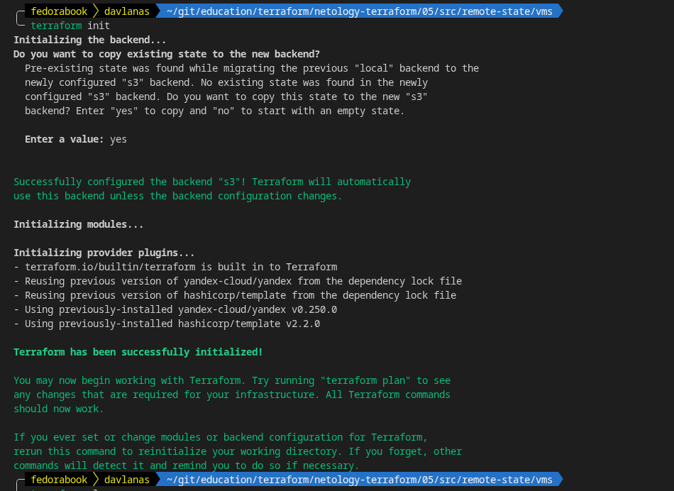

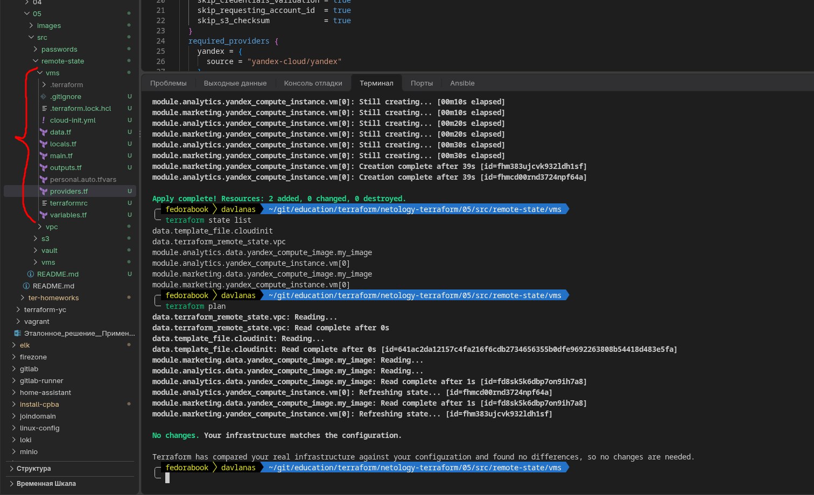 \
Непосредственно видно, что файлы tfstate удалены из директории. 

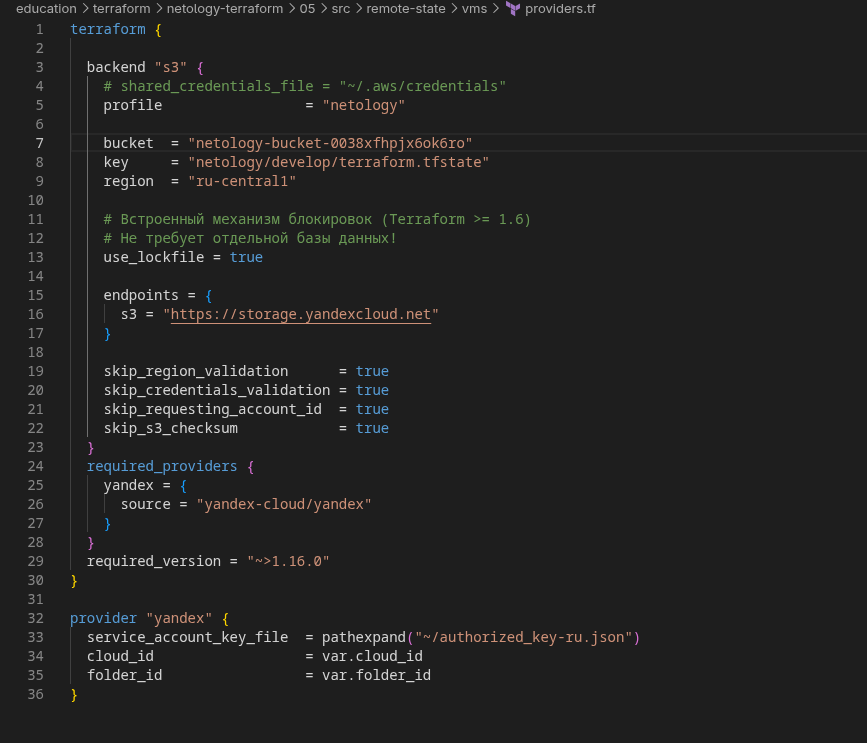 \
Настройки, хотя они вроде как в коде и так будут.

## 4

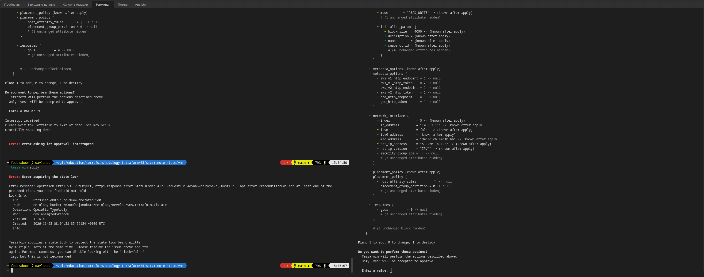 \
Как и на лекции **console** не создала блокировки. Поэтому я изменил название одной из ВМ и запустил **apply** в двух окнах, закономерно в одном из них получив lock.

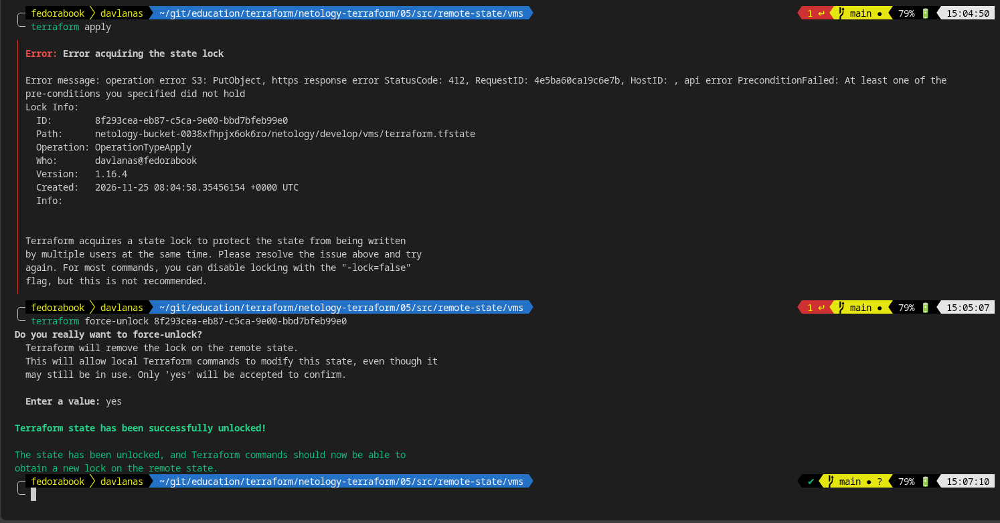 \
Собственно команда о снятии блокировки и ранее полученная ошибка, чтобы было видно ID.

# Задание 3

## Структура ВМ

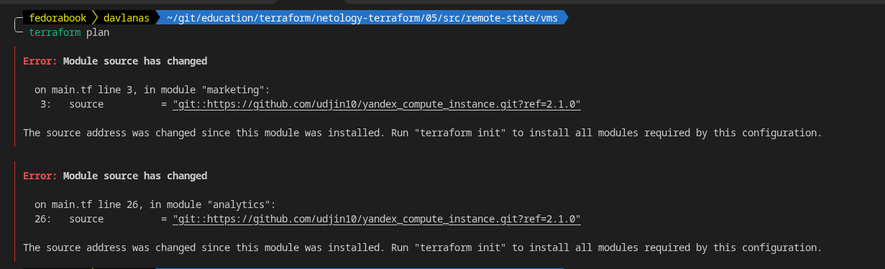 \
**terraform plan** после устранения замечаний tflint
  


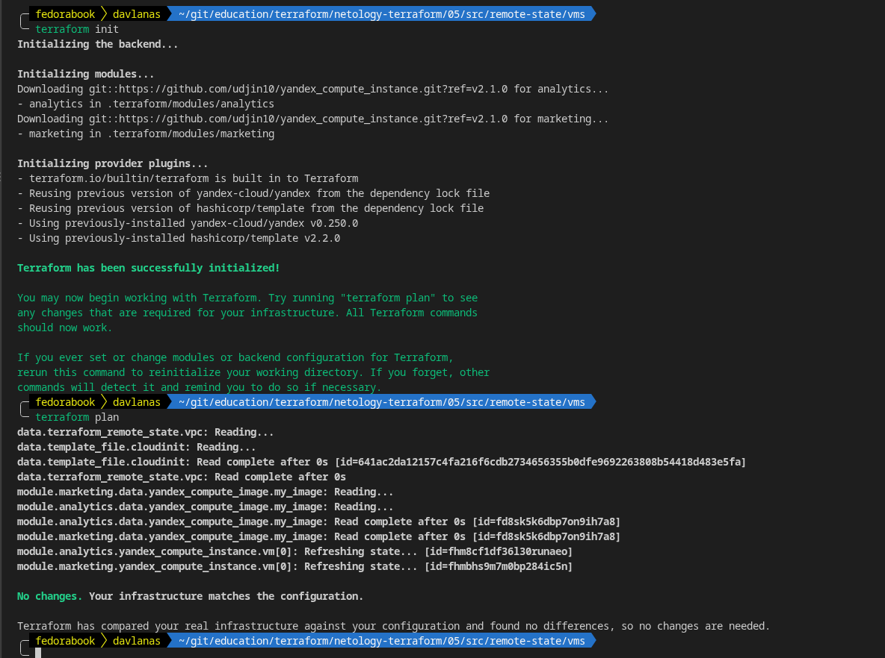 \
**terraform plan** после **terraform init** (загрузили модуль, т.к в его вызове произошли изменения, но переделывать в инфре нечего, т.к суть осталась той же)
  


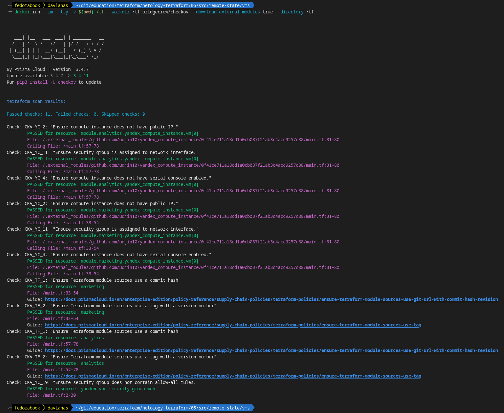 \
**checkov** после исправления всех замечаний. По сути пришлось отключить **NAT**, добавить **security_groups** и вместо версии модуля прописать хэш коммита.

## Структура VPC

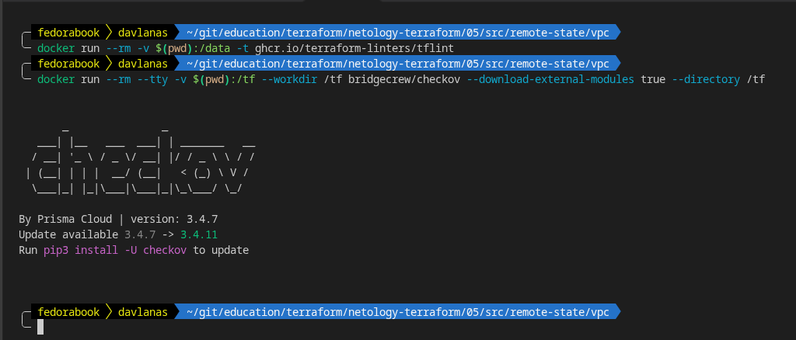 \
Результат **tflint** и **checkov**.

# Задание 4

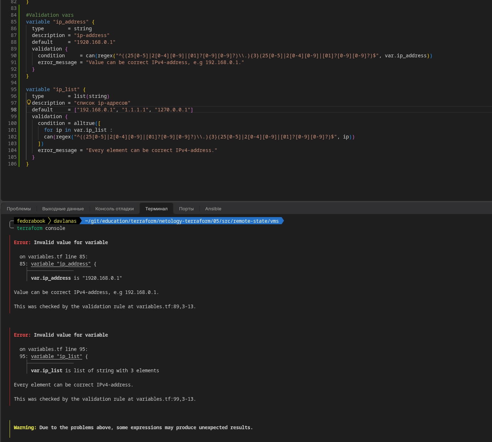 \

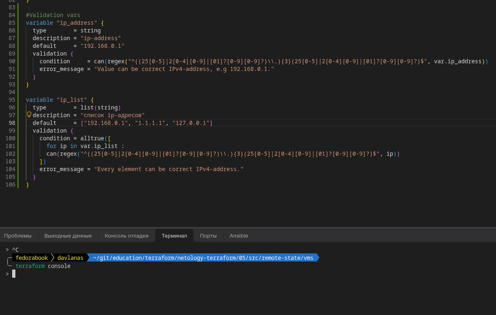 \

# Задание 5

```
variable "any_string" {
  type        = string
  description = "any string"

  validation {
    condition     = can(regex("^[^A-Z]*$", var.any_string))
    error_message = "String can't contains upper symbol (A-Z)."
  }
}

variable "in_the_end_there_can_be_only_one" {
  description = "Who is better Connor or Duncan?"
  type = object({
    Dunkan = optional(bool)
    Connor = optional(bool)
  })

  default = {
    Dunkan = true
    Connor = false
  }

  validation {
    error_message = "There can be only one MacLeod"
    condition     = var.in_the_end_there_can_be_only_one.Dunkan != var.in_the_end_there_can_be_only_one.Connor
  }
}
```
# Задание 6

Импорт в gitlab ручной через ключ, который создал для этих нужд в github. Дальше работает pipeline:
1. Проводит валидацию конфигов
2. Создает план
3. Apply с подтверждением  
4. Destroy с подтверждением

Внутри пришлось пойти на ряд ухищрений и нет проверки линтом и чековым, но на это ушло бы слишком много времени. Это мой первый pipeline. 

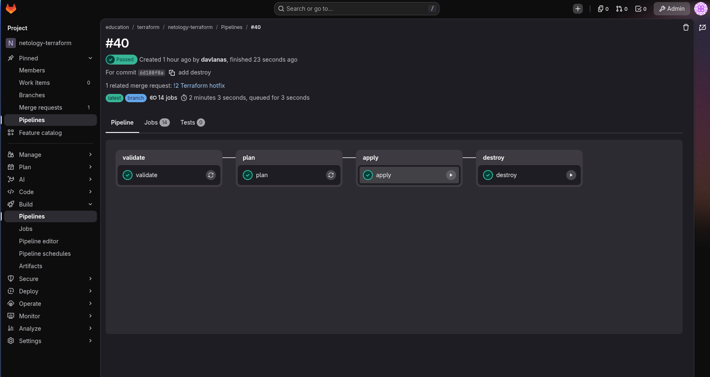 \

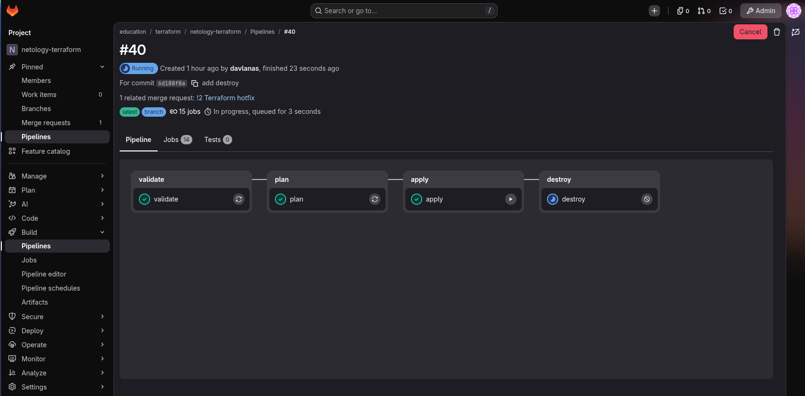 \

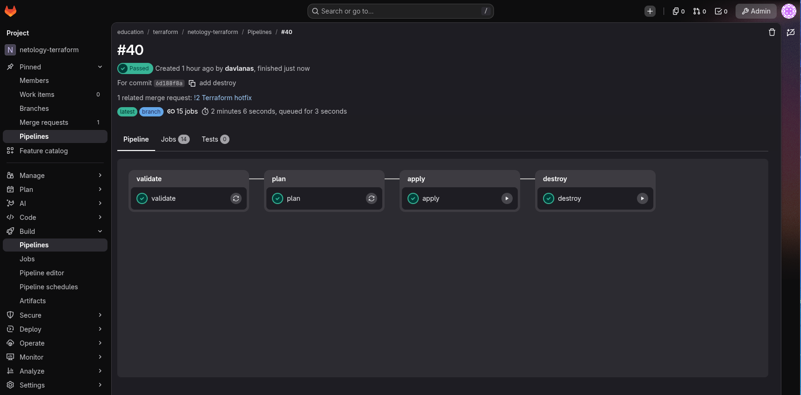 \

# Задание 7

Финальная версия кода - ветка terraform-hotfix в директории remote-state. Там есть переменные с валидацие и отдельный root модуль для S3 из 7го задания. 


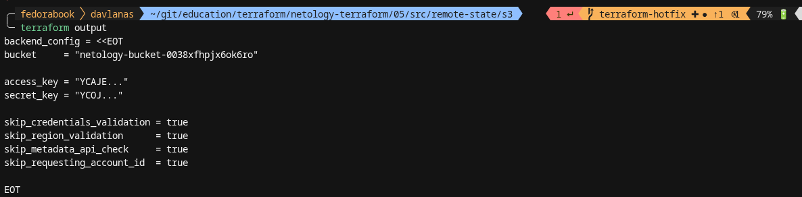 \
Пример вывода образца backend.

Единственное с чем не стал решать проблему - права сервисного аккаунта от которого работает TF. По идее надо ему дать роль admin, но меня от одной мысли об этом коробит.... Нет ни малейшего желания так делать с аккаунтом, креды от которого есть риск потерять в ходе обучения. 